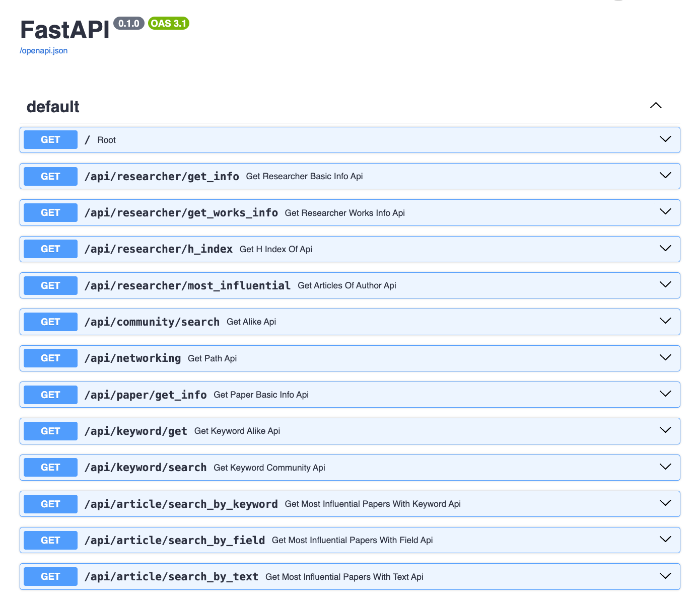

# knowledge-graphs-class
## Intro
This project aims to track academic communities, and also networks across researchers, research articles and keywords. There are 4,894,081 papers and 45,564,149 citation relationships, which is extended by graph relations across venues, institutions, articles, researchers and keywords


[](https://github.com/pylint-dev/pylint)


## Schema:
```
(:Article) ──[:WRITTEN_BY]──> (:Author)
   └──────[:REFERENCES] -> (:Article)
   └──────[:PUBLISHED_IN] -> (:Venue)
   └──────[:HAS_KEYWORD]──────> (:Keyword)
 (:Author) ──────[:WORKS_AT]──────> (:Institution)
```

### 2 Projections 
are available
```
- Networking: (:Author)-[:CO_AUTHORED_WITH]->(:Author)
- KeywordNetwork (:Keyword)-[:SHARED_ARTICLE]->(:Keyword)
```
## Make commands (for convenience)

```
Commands:
  make venv           Create local virtualenv (.venv)
  make install        Install requirements into .venv
  make run            Run FastAPI (uvicorn) on :8000
  make docker-build   Build Docker image (TAG=graph-api:dev)
  make docker-run     Start the Docker Compose stack
  make test           Run pytest suite
  make lint           Run pylint
  make format         Run black code formatter
  make clean          Remove caches and temp files
  make tree           Show project tree (depth 3)
```

## Project structure

```
.
├── __init__.py
├── app
│   ├── __init__.py
│   ├── agent
│   │   ├── __init__.py
│   │   ├── graph.py
│   │   ├── services.py
│   │   └── tools.py
│   ├── demo.ipynb
│   └── main.py
├── badges
│   ├── coverage.svg
│   ├── duration.svg
│   ├── last-run.svg
│   ├── skipped.svg
│   ├── tests.svg
│   ├── warnings.svg
│   └── xfailed.svg
├── docker-compose.yml
├── dockerfile
├── docs
│   └── API_Definition.png
├── makefile
├── neo4j
├── pyproject.toml
├── README.md
├── scripts
├── ├──csv-conversion-all-fields.ipynb
│   ├── __init__.py
│   └── load.py
├── testing
│   ├── test_graph.py
│   ├── test_main.py
│   ├── test_services.py
│   └── test_tools.py
└── uv.lock
```

## Agent Flow
```
                  +-------------------+
                  |       agent       | <--------------------+
                  +-------------------+                      |
                            |                                |
              Conditional Edge (should_continue)             |
            /               |                 \              |
      [Valid Tools]   [Tool Error / []]    [Final Answer]    |
          /                 |                     \          |
         v                  v                      v         |
+--------------+    +---------------+            +-----+     |
| execute_tool |    |  retry_node   |            | END |     |
+--------------+    +---------------+            +-----+     |
       |                    |                                |
       +--------------------+--------------------------------+
``` 
## Available API endpoints


## Graph Schema


## Dataset provenance
Taken from: https://www.kaggle.com/datasets/mathurinache/citation-network-dataset under CC BY-NC-SA 4.0


Sources
https://www.aminer.org/citation

Collection Methodology
The data set is designed for research purpose only. The citation data is extracted from DBLP, ACM, MAG (Microsoft Academic Graph), and other sources. The first version contains 629,814 papers and 632,752 citations. Each paper is associated with abstract, authors, year, venue, and title. The data set can be used for clustering with network and side information, studying influence in the citation network, finding the most influential papers, topic modeling analysis, etc.

## How to start
If it is your first time:


```
chmod +x entrypoint.sh
```
1) navigate to [dataset source](https://www.kaggle.com/datasets/mathurinache/citation-network-dataset). Put the file into scripts folder
2) Run all the cells of [notebook](scripts.csv-conversion-all-fields.ipynb)
3) run following cells
```
docker compose up --build
```
in another terminal
``` 
docker model run docker model run hf.co/bartowski/Llama-3-Groq-8B-Tool-Use-GGUF:Q6_K_L 
```
then navigate to [demo](app/demo.ipynb)

### Important
Due to the large size of the dataset, there is already prepared 5% sample in neo4j.tar.gz archive.

If you don't want to unpack all the data and unload it to Cypher (it can easily take 1+Hour), pass this command instead of bare docker compose

```
CLEAN=1 docker compose up --build
```

You can ignore step 1 and 2 then

